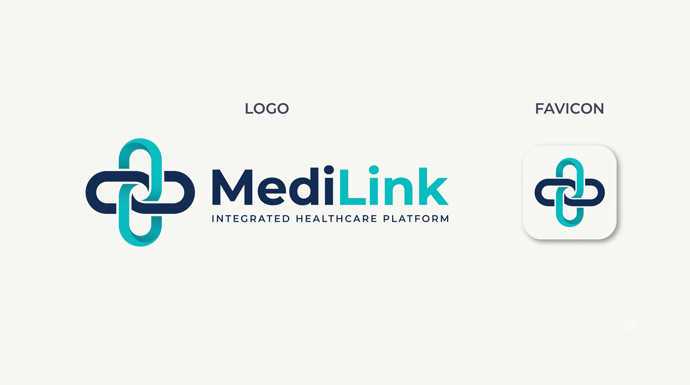
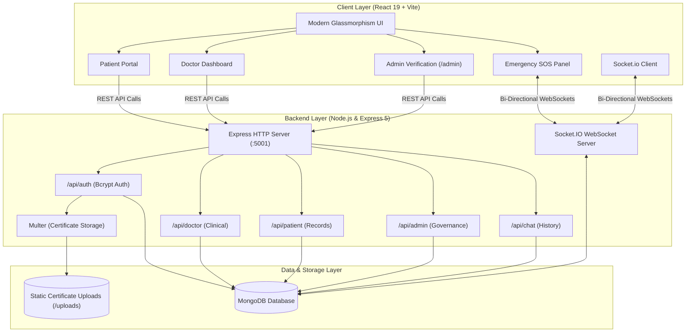

<p align="center">
  
</p>

<h1 align="center">MediLink</h1>

<p align="center">
  <strong>Next-Generation Real-Time Telemedicine, Doctor Verification & Emergency SOS Healthcare Ecosystem</strong>
</p>

<p align="center">
  <a href="#-key-features"></a>
  <a href="#-key-features"></a>
  <a href="#-key-features"></a>
  <a href="#-key-features"></a>
  <a href="#-key-features"></a>
  <a href="#-key-features"></a>
  <a href="./LICENSE"></a>
</p>

<p align="center">
  <a href="#-preview">Preview</a> •
  <a href="#-key-features">Features</a> •
  <a href="#-system-architecture">Architecture</a> •
  <a href="#-real-time-websocket-engine">Socket Protocol</a> •
  <a href="#-tech-stack">Tech Stack</a> •
  <a href="#-quick-start">Quick Start</a> •
  <a href="#-default-credentials">Credentials</a> •
  <a href="#-api-reference">API Reference</a> •
  <a href="#-contributing">Contributing</a>
</p>

---

## 🌟 Overview

**MediLink** is an enterprise-grade full-stack telemedicine and healthcare management platform built on the modern MERN stack with native WebSockets. Designed to solve real-world healthcare delivery friction, MediLink unites **Patients**, **Verified Physicians**, and **Hospital Administrators** into a unified, high-availability digital hospital experience.

From real-time emergency SOS dispatching to automated doctor credential verification, interactive clinical consultations, and digital prescription issuance, MediLink provides instant medical assistance anytime, anywhere.

---

## 📸 Preview

<p align="center">
  
</p>

---

## ⚡ Key Features

### 🚑 1. Real-Time Emergency SOS Dispatcher
* **1-Click Distress Beacon:** Patients can trigger immediate emergency SOS requests categorized by acute trauma, cardiac distress, respiratory failure, or pediatric urgencies.
* **On-Duty Doctor Pool:** Doctors toggle active emergency duty with one switch; incoming SOS signals broadcast instantaneously to on-duty physicians via WebSockets.
* **Instant Claiming & Room Provisioning:** Doctors claim emergency tickets in real-time, instantly spawning a secure, high-priority emergency consultation room.
* **Live GPS / Location Coordinates:** Captures and dispatches patient location coordinates and contact numbers directly to medical teams.

### 👨‍⚕️ 2. Doctor Clinical Suite & Verification
* **Multi-Step Onboarding:** Doctors register with medical credentials, license numbers, specialization, and upload physical degree certificates (PDF, JPG, PNG) processed via Multer.
* **Clinical Triage Workspace:** Interactive dashboard featuring appointments organized by stage (`BOOKED`, `IN_PROGRESS`, `COMPLETED`), with quick-action status toggles.
* **Patient Medical Background Alerts:** Instant display of critical patient vitals, active chronic illnesses, allergies, and emergency contact numbers during consultations.
* **Digital E-Prescription Generator:** Create comprehensive prescriptions detailing drug names, dosage amounts, frequency schedules, durations, follow-up dates, and clinical advice.
* **Prescription Archive:** Historic searchable archive of all past issued medical prescriptions.

### 🧑‍💼 3. Patient Care & Telemedicine Portal
* **Digital Health Profile:** Centralized patient profile storing blood group, medical history, allergies, age, and emergency contact contacts.
* **Verified Doctor Discovery:** Explore verified specialist doctors across cardiology, neurology, pediatrics, orthopedics, and general medicine.
* **Appointment Scheduling:** Book scheduled video/chat consultations with automated calendar slotting.
* **Interactive Consultation Room:** Real-time chat with presence detection (online/offline indicators), live typing indicators, and message history persistence.
* **Prescription Download:** Access, review, and print digital prescriptions issued by doctors immediately following appointments.

### 🛡️ 4. Hospital Admin Verification Center
* **Secured Route (`/admin`):** Pre-seeded administrative gateway for hospital directors and medical boards.
* **Doctor Credential Inspection:** Review pending doctor applications, inspect uploaded medical diplomas and licenses in high definition.
* **One-Click Approval / Rejection:** Instantly verify doctors into the hospital network or reject fraudulent applications with custom feedback reasons.
* **Real-Time System Health Telemetry:** Monitor connected database state, active websocket rooms, and pool metrics.

---

## 🏗️ System Architecture



---

## 🔄 Real-Time WebSocket Engine

MediLink utilizes **Socket.IO** for ultra-low latency, mission-critical healthcare signaling:

| Event Name | Direction | Payload | Description |
| :--- | :--- | :--- | :--- |
| `join_room` | Client ➔ Server | `{ chatRoomId, appointmentId, userRole, userName, userId }` | Joins private consultation room; updates presence and appointment status |
| `doctor_presence` | Server ➔ Client | `{ online, doctorName, joinedAt }` | Notifies patient when their doctor enters or leaves the room |
| `patient_presence` | Server ➔ Client | `{ online, patientName }` | Notifies doctor when patient enters or leaves the room |
| `send_message` | Client ➔ Server | `{ chatRoomId, appointmentId, senderRole, senderName, text }` | Broadcasts and persists medical consultation chat messages |
| `receive_message` | Server ➔ Client | `{ _id, appointmentId, chatRoomId, senderRole, senderName, text, createdAt }` | Delivers real-time messages to both participants |
| `typing` | Client ➔ Server | `{ chatRoomId, senderName, senderRole, isTyping }` | Sends live typing notification |
| `register_doctor_duty` | Client ➔ Server | `{ doctorId, doctorName, isDuty }` | Adds/removes doctor from Emergency Duty Pool |
| `trigger_emergency_sos`| Client ➔ Server | `{ patientId, patientName, patientPhone, emergencyCategory, location, ... }` | Dispatches priority SOS to all on-duty emergency physicians |
| `claim_emergency` | Client ➔ Server | `{ appointmentId, doctorId, doctorName }` | Doctor claims priority emergency ticket and initiates consultation |
| `doctor_entered_consultation` | Server ➔ Broadcast | `{ appointmentId, chatRoomId, doctorName }` | Global alert informing patient doctor has arrived |

---

## 🛠️ Tech Stack

### Frontend
* **Core:** React 19, JavaScript (ESNext)
* **Build Tool:** Vite 8 (Hot Module Replacement)
* **Styling:** Modular Glassmorphic CSS Design System, Responsive Flexbox & Grid
* **Icons:** Lucide React
* **Realtime:** Socket.io-client
* **Linter:** Oxlint (High-speed Rust-based JavaScript linter)

### Backend
* **Runtime:** Node.js (v18.x / v20.x / v22.x)
* **Framework:** Express 5.x
* **Realtime:** Socket.IO 4.x
* **Database:** MongoDB with Mongoose ODM 9.x
* **File Uploads:** Multer (with disk storage & unique filename hash generation)
* **Security:** Bcrypt.js (salt hashing for administrative & user credentials)
* **CORS:** Cross-Origin Resource Sharing enabled

---

## 📂 Project Structure

```
wad/
├── .github/
│   ├── ISSUE_TEMPLATE/
│   │   ├── bug_report.md             # Issue template for bugs
│   │   └── feature_request.md        # Issue template for feature proposals
│   ├── workflows/
│   │   └── ci.yml                    # Automated GitHub Actions CI workflow
│   └── PULL_REQUEST_TEMPLATE.md      # Standardized pull request template
├── assets/
│   ├── logo.png                      # MediLink high-resolution transparent logo
│   └── preview.png                   # Platform dashboard showcase screenshot
├── client/                           # React 19 + Vite Frontend Application
│   ├── public/                       # Static public assets (favicons, logos)
│   ├── src/
│   │   ├── components/
│   │   │   ├── AdminPortal.jsx       # Doctor verification & platform governance
│   │   │   ├── DoctorAuth.jsx        # Doctor registration & certificate upload
│   │   │   ├── DoctorDashboard.jsx   # Clinical queue, prescriptions & consultations
│   │   │   ├── EmergencyPanel.jsx    # Real-time Emergency SOS dispatch modal
│   │   │   ├── Features.jsx          # Interactive feature presentation
│   │   │   ├── Footer.jsx            # Platform footer with emergency hotlines
│   │   │   ├── Hero.jsx              # Landing hero banner with quick CTA
│   │   │   ├── Navbar.jsx            # Sticky navigation with live API health pulse
│   │   │   ├── PatientAuth.jsx       # Patient registration & login
│   │   │   └── PatientDashboard.jsx  # Health history, booking & live chat
│   │   ├── App.css                   # Global app layout rules
│   │   ├── App.jsx                   # Main root view router & state manager
│   │   ├── index.css                 # Master design system & CSS custom variables
│   │   ├── main.jsx                  # React DOM entry point
│   │   └── socket.js                 # Centralized Socket.io client connector
│   ├── .env.example                  # Client environment template
│   ├── .gitignore                    # Client-specific Git ignore rules
│   ├── .oxlintrc.json                # Oxlint linter configuration
│   ├── index.html                    # Single-page application HTML entry
│   ├── package.json                  # Frontend dependencies & scripts
│   └── vite.config.js                # Vite build configuration
├── server/                           # Node.js + Express 5 Backend API
│   ├── src/
│   │   ├── config/
│   │   │   ├── db.js                 # MongoDB connection handler
│   │   │   └── seedAdmin.js          # Auto-seeds default Administrator account
│   │   ├── models/
│   │   │   ├── Appointment.js        # Consultation & Emergency appointment schema
│   │   │   ├── Message.js            # Real-time chat message schema
│   │   │   ├── Prescription.js       # Digital prescription & medicine schema
│   │   │   └── User.js               # Polymorphic User schema (Patient, Doctor, Admin)
│   │   ├── routes/
│   │   │   ├── adminRoutes.js        # Doctor approvals, rejection & management
│   │   │   ├── authRoutes.js         # Patient & Doctor auth with Multer upload
│   │   │   ├── chatRoutes.js         # Chat message history REST endpoints
│   │   │   ├── doctorRoutes.js       # Appointments, duty toggle, prescriptions
│   │   │   └── patientRoutes.js      # Profile update, doctor search, bookings
│   │   └── server.js                 # Main server entry (Express + Socket.io + Health)
│   ├── uploads/
│   │   └── certificates/             # Uploaded medical license documents
│   │       └── .gitkeep              # Preserves directory in version control
│   ├── .env.example                  # Backend environment template
│   ├── .gitignore                    # Server-specific Git ignore rules
│   └── package.json                  # Server dependencies & scripts
├── .env.example                      # Root environment configuration guide
├── .gitignore                        # Global repository Git ignore rules
├── CODE_OF_CONDUCT.md                # Contributor Covenant Code of Conduct
├── CONTRIBUTING.md                   # Contribution workflow & pull request guide
├── LICENSE                           # Open-source MIT License
├── package.json                      # Root workspace scripts runner
└── README.md                         # Project documentation
```

---

## 🚀 Quick Start

### Prerequisites
* [Node.js](https://nodejs.org/) (v18.x or v20.x+ recommended)
* [MongoDB](https://www.mongodb.com/try/download/community) installed and running locally on port `27017` (or a [MongoDB Atlas](https://www.mongodb.com/cloud/atlas) URI)
* [Git](https://git-scm.com/)

---

### Step 1: Clone the Repository
```bash
git clone https://github.com/harshil51/MedLink-.git
cd MedLink-
```

---

### Step 2: Configure Environment Variables

1. **Backend Environment:**
   Create a `.env` file inside the `server/` directory:
   ```bash
   cp server/.env.example server/.env
   ```
   *Default values in `server/.env`:*
   ```env
   PORT=5001
   MONGO_URI=mongodb://127.0.0.1:27017/medilink
   NODE_ENV=development
   ```

2. **Frontend Environment:**
   Create a `.env` file inside the `client/` directory (optional for local development):
   ```bash
   cp client/.env.example client/.env
   ```

---

### Step 3: Install Dependencies

You can install all dependencies from the root directory with one command:
```bash
npm run install:all
```

*Or install them individually:*
```bash
# In the server folder:
cd server && npm install

# In the client folder:
cd ../client && npm install
```

---

### Step 4: Start MongoDB
Ensure MongoDB is running locally:
```bash
# On Windows (PowerShell or Services):
net start MongoDB

# Or run mongod directly:
mongod --dbpath <path-to-data-dir>
```

---

### Step 5: Run Development Servers

Open two terminal tabs:

**Terminal 1 (Backend API & WebSockets):**
```bash
# From root:
npm run dev:server

# Or inside /server:
cd server
npm run dev
```
> Server runs on `http://localhost:5001` (Auto-seeds default Admin account).

**Terminal 2 (Frontend Client):**
```bash
# From root:
npm run dev:client

# Or inside /client:
cd client
npm run dev
```
> Client launches on `http://localhost:5173`. Open this URL in your browser!

---

## 🔑 Default Credentials

On initial startup, MediLink automatically seeds the hospital administrator account into MongoDB:

| Portal | URL / Route | Email | Password | Role |
| :--- | :--- | :--- | :--- | :--- |
| **Hospital Admin Portal** | `http://localhost:5173` ➔ Click `/admin` or URL `#admin` | `admin@medilink.in` | `Admin@123` | `ADMIN` |
| **Doctor Registration** | `http://localhost:5173` ➔ Doctor Login ➔ Sign Up | *(Register your own)* | *(Your Password)* | `DOCTOR` |
| **Patient Registration** | `http://localhost:5173` ➔ Patient Login ➔ Register | *(Register your own)* | *(Your Password)* | `PATIENT` |

### 💡 Quick Testing Flow:
1. **Register as a Doctor:** Click **Doctor Portal**, register with credentials, and upload any dummy document as your license.
2. **Approve Doctor:** Switch to `/admin` or click Admin in the header, login with `admin@medilink.in` / `Admin@123`, view the pending doctor application, and click **Approve Doctor**.
3. **Register as a Patient:** Sign up in the Patient Portal, fill in health details, search for your newly approved doctor, and book an appointment!
4. **Experience Live Consultation:** Open two browser windows side-by-side (one logged in as Doctor, one as Patient) to experience real-time chat, typing indicators, and emergency claiming!

---

## 📡 API Reference

### Health & Telemetry
| Method | Endpoint | Description |
| :--- | :--- | :--- |
| `GET` | `/api/health` | Live system health, DB connection status, and socket room counters |

### Authentication (`/api/auth`)
| Method | Endpoint | Description |
| :--- | :--- | :--- |
| `POST` | `/api/auth/patient/register` | Register a new patient account |
| `POST` | `/api/auth/patient/login` | Authenticate patient credentials |
| `POST` | `/api/auth/doctor/register` | Register doctor (multipart/form-data with certificate upload) |
| `POST` | `/api/auth/doctor/login` | Authenticate verified doctor credentials |

### Admin Portal (`/api/admin`)
| Method | Endpoint | Description |
| :--- | :--- | :--- |
| `POST` | `/api/admin/login` | Authenticate hospital administrator |
| `GET` | `/api/admin/doctors` | Fetch pending and approved doctor accounts |
| `PATCH`| `/api/admin/doctors/:id/approve` | Approve a doctor's medical license |
| `DELETE`| `/api/admin/doctors/:id` | Reject or delete a doctor account |

### Doctor Suite (`/api/doctor`)
| Method | Endpoint | Description |
| :--- | :--- | :--- |
| `GET` | `/api/doctor/:doctorId/appointments` | Get live appointments with patient vitals and allergies |
| `POST` | `/api/doctor/prescriptions` | Generate and link digital prescription |
| `GET` | `/api/doctor/:doctorId/prescriptions` | Retrieve doctor's historic issued prescriptions |
| `PATCH`| `/api/doctor/:doctorId/duty` | Toggle Emergency On-Duty availability |

### Patient Suite (`/api/patient`)
| Method | Endpoint | Description |
| :--- | :--- | :--- |
| `GET` | `/api/patient/doctors` | List all verified, approved doctors available for booking |
| `PUT` | `/api/patient/:patientId/profile` | Update medical profile, allergies, and emergency contacts |
| `GET` | `/api/patient/:patientId/appointments` | Get patient appointment history and consultation statuses |
| `POST` | `/api/patient/appointments` | Book a consultation with a chosen doctor |
| `GET` | `/api/patient/:patientId/prescriptions` | Fetch all prescriptions issued to patient |

### Real-Time Chat (`/api/chat`)
| Method | Endpoint | Description |
| :--- | :--- | :--- |
| `GET` | `/api/chat/:appointmentId/messages` | Load message history for a consultation |
| `POST` | `/api/chat/:appointmentId/messages` | Fallback REST endpoint for chat messages |

---

## 🧪 Testing & Validation

```bash
# Run Frontend Lint Checks (Oxlint)
npm run lint:client

# Validate Frontend Production Bundle
npm run build:client

# Validate Backend Syntax
node --check server/src/server.js
```

---

## 🔒 Security & Privacy

* **Password Hashing:** Passwords are never stored in plaintext; salted with 10 rounds using `bcryptjs`.
* **File Upload Protection:** Doctor credentials are saved with sanitized extensions and randomized timestamps.
* **Environment Isolation:** Sensitive database strings and port bindings are decoupled into `.env`.
* **Privacy By Design:** Test uploads and personal documents are excluded from version control via strict `.gitignore` filters.

---

## 🤝 Contributing

Contributions make the open-source community an amazing place to learn, inspire, and create. Any contributions you make are **greatly appreciated**.

1. Fork the Project
2. Create your Feature Branch (`git checkout -b feature/AmazingFeature`)
3. Commit your Changes (`git commit -m 'Add some AmazingFeature'`)
4. Push to the Branch (`git push origin feature/AmazingFeature`)
5. Open a Pull Request

Please read our [Contributing Guidelines](./CONTRIBUTING.md) and [Code of Conduct](./CODE_OF_CONDUCT.md).

---

## 📄 License

Distributed under the **MIT License**. See [`LICENSE`](./LICENSE) for more details.

---

<p align="center">
  <strong>Built with ❤️ for accessible healthcare and lifesaving telemedicine.</strong>
</p>
